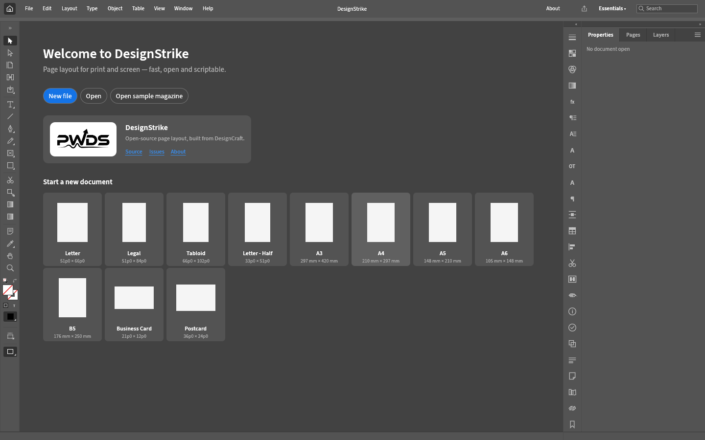
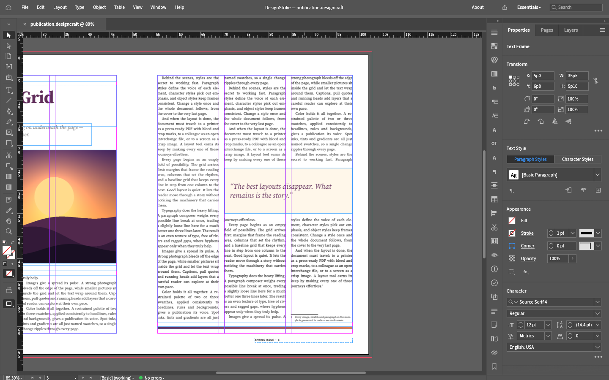

# DesignStrike

DesignStrike is an independent PWDS source fork of [DesignCraft](https://github.com/storytold/designcraft), a complete Rust page-layout application. This repository includes the native desktop editor, headless CLI, web host, layout and composition engine, PDF and interchange exporters, and supporting crates. It is an application foundation, with release readiness tracked in [integration status](docs/DESIGNSTRIKE_STATUS.md).

The source snapshot is pinned to DesignCraft commit [`a930276fd7462f3d9abd2fbb38544c94c0c911c8`](https://github.com/storytold/designcraft/commit/a930276fd7462f3d9abd2fbb38544c94c0c911c8). Internal `designcraft-*` package names and `.designcraft` files remain for compatibility. The native window, welcome screen, About panel and project links identify DesignStrike. The approved PWDS mark appears on the welcome screen and in About. The inherited open-licensed cat app icon is temporary; release packaging still needs an independent identity review.

## Source and licences

Inherited software is available under MIT OR Apache-2.0; see [NOTICE](NOTICE), [MIT](LICENSE-MIT), [Apache-2.0](LICENSE-APACHE), and [asset attribution](ASSETS.md). Upstream `docs/brand/` artwork and its code-drawn trademark outline are absent from this repository's public root history. The existing PWDS mark has [separate owner terms](assets/branding/LICENSE-brand.txt). DesignStrike is not endorsed by the original project.

## Build and workflow

The workspace declares Rust 1.95. Native binaries retain their upstream package names:

```sh
cargo run --release -p designcraft -- --sample
cargo run --release -p designcraft-cli -- run --sample --export publication.pdf
```

The inherited sample magazine and CLI provide a reproducible way to exercise pages, styles, text composition, images and export. The [status page](docs/DESIGNSTRIKE_STATUS.md) distinguishes verified DesignStrike behavior from inherited source features and records the remaining publication gates.

## Verified native workflow

The [bounded hosted run](https://github.com/Gerbzz/DesignStrike/actions/runs/38729864589) built the full desktop and CLI, passed the focused deletion/bleed regressions and the engine/renderer library suites, edited and saved a five-page publication in the native application, reopened it in a separate CLI process, and exported [PDF](docs/evidence/designstrike-synthetic-publication.pdf), five page PNGs and an IDML round trip. All five PNG and PDF pages were visually inspected. The [verification report](docs/evidence/designstrike-verification.json) and [evidence index](docs/DESIGNSTRIKE_STATUS.md#verification) record the exact checks and limits.





## Current limits

The reported Primary Text Frame deletion case now has a verified focused fix; the upstream [gap list](docs/gaps.md) remains open for broader text-flow cases. Real publication work also needs validated layout fidelity, fonts, preflight, PDF output, and platform-specific behavior. No installer or production-readiness claim is made here.
