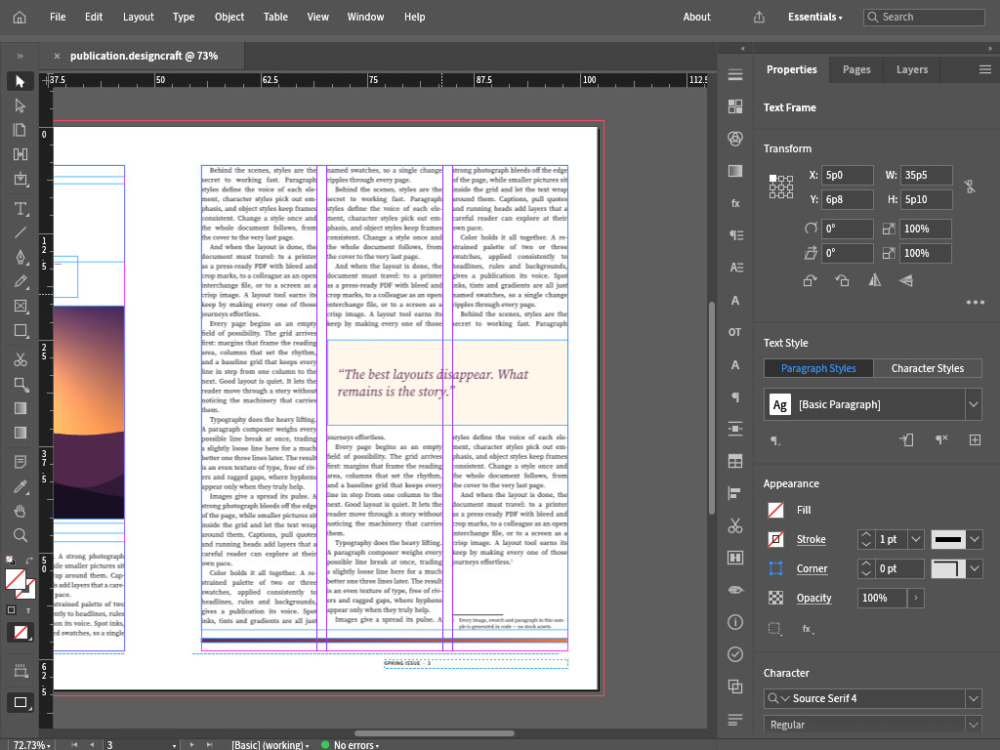
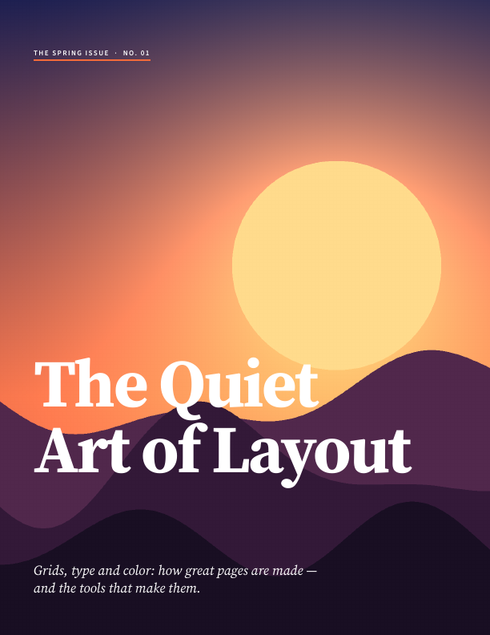

# DesignStrike

**Open-source page layout in Rust.** Arrange text and artwork across pages in a native editor, keep editable documents, and export publications through a matching CLI.



*An unmodified `ui.screenshot` from the real DesignStrike desktop process on a standard hosted Windows 2025 runner, showing page three of a synthetic publication. [See the green run](https://github.com/Gerbzz/DesignStrike/actions/runs/38746493794) and [the edited fifth page](docs/images/designstrike-edited-page-windows2025.png).*

DesignStrike is an independent early-alpha fork of the complete [DesignCraft](https://github.com/storytold/designcraft) Rust application. The workspace contains a native editor, document and layout engine, text composition, headless CLI, PDF and IDML interchange paths, and a web host. The features below are present in source; the [verification table](#verified-workflows) separates exercised behavior from untested capability.

## Create and publish pages

- **Lay out publications:** pages and spreads, text frames, styles, images, parent pages, and bleeds are represented in the document model and editor.
- **Edit through commands:** the UI and control channel use the document engine. A synthetic five-page magazine was edited in the actual desktop process, saved, and reopened.
- **Export and interchange:** the CLI can export page PNGs and PDF and round-trip IDML in the tested synthetic workflow. Native `.designcraft` files and internal `designcraft-*` package names remain for compatibility.



*The cover rasterized from the **Ubuntu-generated** five-page synthetic PDF. [Pages two](docs/evidence/designstrike-pdf-page2.png), [three](docs/evidence/designstrike-pdf-page3.png), [four](docs/evidence/designstrike-pdf-page4.png), and [five](docs/evidence/designstrike-pdf-page5.png) are also retained. These are not Windows PDF renders.*

## Verified workflows

| Environment | Result |
| --- | --- |
| [Windows 2025](https://github.com/Gerbzz/DesignStrike/actions/runs/38746493794) | Built the desktop editor and CLI; passed focused page-deletion and facing-page bleed regressions; drove the live editor to create and save a five-page document; captured [About](docs/images/designstrike-about-windows2025.png), the editor above, and [page five](docs/images/designstrike-edited-page-windows2025.png). A separate CLI process reopened the file and exported five PNG pages, PDF, and IDML. Its PDF was checked for page count and selectable text, **not rasterized on Windows**. |
| [Ubuntu 24.04](https://github.com/Gerbzz/DesignStrike/actions/runs/38729864589) | Built the full editor and CLI; passed 565 engine and 35 renderer library tests plus focused regressions; edited and reopened a five-page document; exported [the synthetic PDF](docs/evidence/designstrike-synthetic-publication.pdf) and page PNGs; rasterized and visually inspected all five PDF pages; and round-tripped five-page IDML. |
| Regression evidence | The [unfixed run](https://github.com/Gerbzz/DesignStrike/actions/runs/38729078701) reproduced page regeneration and inside-bleed faults; the [passing run](https://github.com/Gerbzz/DesignStrike/actions/runs/38729864589) verified the focused corrections. Scope and logs are in the [status ledger](docs/DESIGNSTRIKE_STATUS.md). |
| Text-wrap reflow | A [red run](https://github.com/Gerbzz/DesignStrike/actions/runs/38772114929) reproduced primary-story overset after enabling wrap. The [Ubuntu fix run](https://github.com/Gerbzz/DesignStrike/actions/runs/38772715516) passed the focused test, 566 engine and 35 renderer tests, and the five-page publication workflow; [Windows smoke](https://github.com/Gerbzz/DesignStrike/actions/runs/38772715620) also passed. |

The images and results above come from application work in [PR #1](https://github.com/Gerbzz/DesignStrike/pull/1). The test publication is generated in code. Real publications still need checks for text flow, font substitution, overset, PDF appearance on Windows, preflight, IDML interoperability, and print fidelity. **No installer or production release is offered.**

## Build from source

Install Rust 1.95 or newer and your platform's native graphics/windowing dependencies. The source keeps the compatible internal package names:

```sh
git clone https://github.com/Gerbzz/DesignStrike.git
cd DesignStrike
cargo build --locked -p designcraft -p designcraft-cli
cargo run --locked -p designcraft -- --sample
cargo run --locked -p designcraft-cli -- run --sample --export publication.pdf
```

These source commands do not create an installer. The [verification ledger](docs/DESIGNSTRIKE_STATUS.md) records exact tested commits, synthetic workflow evidence, and remaining publication gates.

## Project and credits

The full foundation is pinned to [DesignCraft commit `a930276fd7462f3d9abd2fbb38544c94c0c911c8`](https://github.com/storytold/designcraft/commit/a930276fd7462f3d9abd2fbb38544c94c0c911c8). The original [MIT](LICENSE-MIT) and [Apache-2.0](LICENSE-APACHE) licences, [NOTICE](NOTICE) and [asset credits](ASSETS.md) remain. The inherited openly licensed cat app icon is temporary artwork, not a finished DesignStrike icon.


DesignStrike is published by PWDS. Its existing mark has [separate brand terms](assets/branding/LICENSE-brand.txt). DesignStrike is independent of and not endorsed by ArtCraft.
